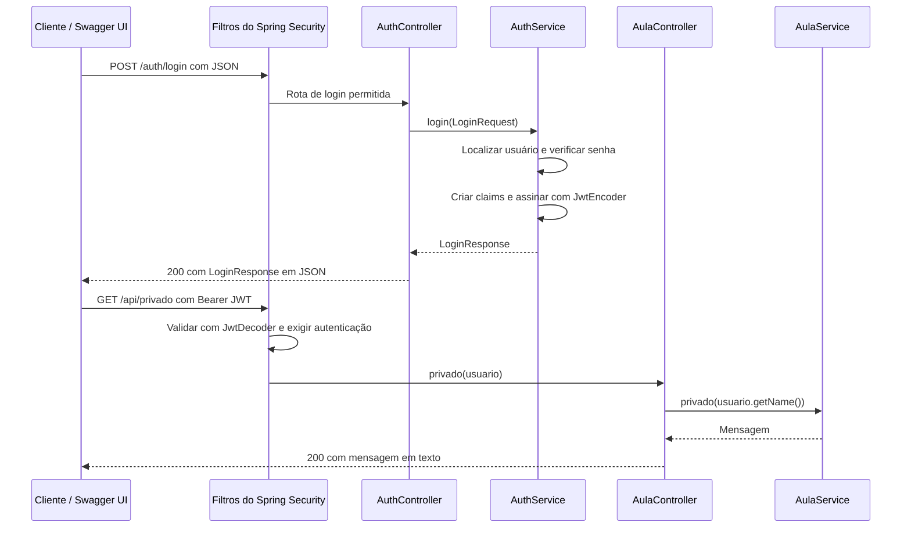

# Segurança de backend com Spring Boot, JWT e OpenAPI

Este é um pequeno projeto de estudo. Você vai entender os conceitos básicos, executar a API, fazer login e usar um token para acessar uma rota protegida. Siga as seções na ordem e consulte o código quando indicado.

O código segue o fluxo **controller → service**: o controller recebe a requisição e monta a resposta HTTP; o service executa as regras, como verificar credenciais e gerar o JWT. Os DTOs representam os dados de entrada e saída.

Nesta versão, as rotas exigem autenticação por padrão. As exceções da API são `POST /auth/login` e `GET /api/publico`; os endereços da documentação também ficam acessíveis para testar pelo navegador. O Swagger usa Bearer globalmente, sem anotações de segurança nos controllers. Não há perfis ou permissões adicionais: basta um JWT válido para acessar as rotas protegidas.

## 1. Por que proteger o backend?

Uma API precisa decidir **quem faz a requisição** e **o que essa pessoa pode fazer**. Esconder um botão na interface não protege os dados: alguém ainda pode chamar a API diretamente. As regras de acesso precisam ser aplicadas no servidor.

| Conceito | Significado | Neste projeto |
|---|---|---|
| Autenticação | Conferir a identidade | Verificar usuário e senha no login |
| Autorização | Decidir o acesso | Permitir as rotas protegidas somente para usuários autenticados |
| Credencial | Prova apresentada | Senha no login; token nas chamadas seguintes |
| Hash de senha | Forma adequada de armazenar senha | BCrypt, sem guardar a senha em texto puro |

**Lembrete:** autenticação responde “quem é?”; autorização responde “pode fazer isto?”.

## 2. O que é um JWT?

JWT (*JSON Web Token*) é um formato de token. Em geral, tem três partes separadas por pontos: `cabeçalho.conteúdo.assinatura`. Neste projeto, o conteúdo inclui `sub` (usuário) e `exp` (expiração). O token dura **15 minutos**.

O conteúdo do JWT é **codificado, não criptografado**: quem obtiver o token pode ler seus dados. A assinatura permite ao backend verificar se ele foi alterado. Por isso, não coloque senha ou informações sigilosas no token.

O token é enviado no cabeçalho `Authorization: Bearer TOKEN`. Quem possui um token Bearer válido pode apresentá-lo. Trate-o como uma credencial: use HTTPS fora do laboratório, não o compartilhe e não o registre em logs.

### Fluxo em seis passos

1. O cliente envia usuário e senha para `POST /auth/login`.
2. O `AuthController` encaminha os dados ao `AuthService`, que compara a senha informada com o hash armazenado.
3. Se a senha estiver correta, o service cria e assina um JWT com validade curta; o controller devolve os dados do token na resposta HTTP.
4. O cliente chama a rota privada enviando `Authorization: Bearer TOKEN`.
5. O Spring Security verifica assinatura e expiração do token.
6. A regra geral exige um usuário autenticado para acessar as rotas protegidas.

`200` indica sucesso; `401`, autenticação ausente ou inválida; `403`, acesso proibido por uma regra de autorização. Nesta versão, as rotas protegidas exigem apenas autenticação, sem perfis ou permissões adicionais. Uma senha errada no login também resulta em `401`.

## 3. O que é OpenAPI? E Swagger UI?

**OpenAPI** é uma especificação para descrever as rotas de uma API. **Swagger UI** é uma página que lê essa descrição e permite executar as chamadas pelo navegador. Neste projeto, a biblioteca **Springdoc OpenAPI** gera a descrição a partir dos controllers e disponibiliza a interface Swagger UI.

A descrição fica em `http://localhost:8080/v3/api-docs`; a interface fica em `http://localhost:8080/swagger-ui.html`. Para testar uma rota protegida, você fará login e colará o JWT no botão **Authorize**.

## 4. Preparar e executar

Instale **JDK 17 ou superior** e **Maven 3.6.3 ou superior**. Confira no terminal:

```text
java -version
mvn -version
```

O resultado de `mvn -version` também deve indicar Java 17 ou superior. Se mostrar Java 8, ajuste `JAVA_HOME` para o JDK novo e abra outro terminal. Você pode usar IntelliJ IDEA, Eclipse, VS Code ou só o terminal.

Depois de baixar ou clonar este repositório, abra um terminal na raiz do repositório, onde estão este `README.md` e o `pom.xml`, e inicie a aplicação:

```text
mvn spring-boot:run
```

Espere a mensagem `Started SegurancaApplication`. A API local usa a porta **8080**. Se estiver ocupada, use `mvn spring-boot:run -Dspring-boot.run.arguments=--server.port=8081` e troque `8080` por `8081` nos endereços seguintes. Para parar, pressione `Ctrl+C`.

O usuário de demonstração é **`aluno`**, com senha **`Senha123!`**. Ele existe apenas em memória, e a senha é transformada em hash BCrypt na inicialização. A chave que assina os tokens é gerada ao iniciar: **reiniciar a aplicação invalida os tokens anteriores**.

| Rota | Método | Token necessário? | Resposta esperada |
|---|---|---|---|
| `/api/publico` | GET | Não | `200` |
| `/auth/login` | POST | Não | `200` e `access_token` com credenciais corretas |
| `/api/privado` | GET | Sim, token válido | `200`; sem token ou com token inválido: `401` |

### Autenticação por padrão

Todas as rotas da API exigem um JWT válido, exceto `POST /auth/login` e `GET /api/publico`:

```java
.authorizeHttpRequests(auth -> auth
        .requestMatchers(HttpMethod.POST, "/auth/login").permitAll()
        .requestMatchers(HttpMethod.GET, "/api/publico").permitAll()
        .requestMatchers(HttpMethod.GET, "/swagger-ui.html", "/swagger-ui/**", "/v3/api-docs/**").permitAll()
        .anyRequest().authenticated())
```

Os GETs da documentação também estão liberados para abrir o Swagger e fazer login pela interface. Uma nova rota de aplicação fica protegida automaticamente, sem adicionar regras ou anotações no controller. Para torná-la pública, adicione uma exceção específica em `SecurityConfig` e atualize `OpenApiConfig` para que o Swagger mostre a mesma regra.

As regras são avaliadas na ordem: a primeira que corresponder à requisição será usada. Por isso, as exceções vêm antes de `anyRequest().authenticated()`, que cobre todo o restante. A liberação combina **método HTTP e caminho**: liberar `POST /auth/login` não libera `GET /auth/login`; liberar `GET /api/publico` não libera `POST /api/publico`. Essas outras combinações exigem autenticação, mas isso não cria métodos novos nos controllers.

A proteção é aplicada por Spring Security. A configuração OpenAPI apenas informa ao Swagger em quais operações enviar o Bearer, e não autoriza chamadas por conta própria.

### Desenvolver com DevTools

O projeto inclui Spring Boot DevTools para reiniciar a aplicação automaticamente quando os arquivos compilados mudarem. Inicie com `mvn spring-boot:run`, altere e salve o código e, em outro terminal na raiz do repositório, execute `mvn compile`. No IntelliJ IDEA, use **Build → Build Project**; no Eclipse, salvar com a compilação automática habilitada já atualiza as classes.

Após uma reinicialização, faça login novamente e atualize o token em **Authorize**: a chave JWT deste exemplo é recriada a cada início. A versão do DevTools é gerenciada pelo Spring Boot. A dependência tem escopo `runtime` e é opcional; o plugin Spring Boot a exclui do JAR executável empacotado por padrão. Consulte a [documentação do DevTools](https://docs.spring.io/spring-boot/reference/using/devtools.html) para os detalhes de reinicialização.

## 5. Testar pelo Swagger UI

Abra **http://localhost:8080/swagger-ui.html**. Um redirecionamento para `/swagger-ui/index.html` é normal.

O Swagger mostra o cadeado nas operações protegidas. `POST /auth/login` e `GET /api/publico` ficam sem essa exigência, pois sobrescrevem a configuração global. Se já houver um token preenchido de um teste anterior, use **Authorize → Logout** antes de começar.

1. Expanda **GET `/api/publico`**, clique em **Try it out** e **Execute**. Confira a resposta `200`.
2. Expanda **GET `/api/privado`** e execute sem token. Confira `401`. O cadeado mostra que a operação exige autenticação.
3. Expanda **POST `/auth/login`**, clique em **Try it out** e use este corpo:

   ```json
   {"usuario":"aluno","senha":"Senha123!"}
   ```

4. Clique em **Execute**. Na resposta `200`, copie apenas o valor de `access_token`, sem aspas.
5. Clique em **Authorize**, no alto da página. Cole o token no campo `bearerAuth` e confirme. **Não escreva `Bearer` antes do token**: a interface adiciona esse prefixo automaticamente.
6. Execute **GET `/api/privado`** novamente. Confira `200` e a mensagem `Olá, aluno. Token válido!`. Na área **Curl** da interface, observe o cabeçalho `Authorization: Bearer ...`.
7. Para testar sem token novamente, clique em **Authorize → Logout**. Se o token expirar ou você reiniciar a API, refaça o login e atualize o token no botão **Authorize**.

O botão **Authorize** guarda o token para as chamadas feitas pelo Swagger; ele não realiza o login. Já **Logout** remove o token da interface, sem revogá-lo no servidor. Depois de autorizar, novas rotas protegidas também recebem esse Bearer automaticamente.

Se continuar recebendo `401`, confira se copiou o token inteiro, sem aspas, espaços ou a palavra `Bearer`.

### Alternativa: PowerShell

Com a aplicação ligada, execute em outro terminal:

```powershell
# Rota pública: 200
Invoke-RestMethod http://localhost:8080/api/publico

# Rota privada sem token: 401
try { Invoke-WebRequest http://localhost:8080/api/privado } catch { [int]$_.Exception.Response.StatusCode }

# Login
$corpo = @{ usuario = 'aluno'; senha = 'Senha123!' } | ConvertTo-Json
$login = Invoke-RestMethod -Uri http://localhost:8080/auth/login -Method Post -ContentType 'application/json' -Body $corpo

# Rota privada com token: 200
Invoke-RestMethod -Uri http://localhost:8080/api/privado -Headers @{ Authorization = "Bearer $($login.access_token)" }
```

## 6. Entender o código

O código está organizado por responsabilidade:

```text
./
├── .gitignore
├── README.md
├── pom.xml
└── src/main/java/br/unipar/seguranca/
    ├── SegurancaApplication.java
    ├── config/
    │   ├── OpenApiConfig.java
    │   └── SecurityConfig.java
    ├── controller/
    │   ├── AulaController.java
    │   └── AuthController.java
    ├── dto/
    │   ├── LoginRequest.java
    │   └── LoginResponse.java
    └── service/
        ├── AulaService.java
        └── AuthService.java
```

O pacote `controller` recebe as requisições HTTP, chama os services e monta as respostas. O pacote `service` executa as regras e devolve dados, sem usar `ResponseEntity` ou códigos HTTP. O pacote `config` reúne as configurações de segurança e documentação OpenAPI. O pacote `dto` contém os dados de entrada e saída do login. A classe `SegurancaApplication` fica no pacote principal para que o Spring encontre automaticamente os controllers, services e configurações nos subpacotes.

Leia os arquivos nesta ordem:

1. [`pom.xml`](pom.xml): dependências Spring Web MVC, Security, Resource Server e Springdoc OpenAPI.
2. [`SecurityConfig.java`](src/main/java/br/unipar/seguranca/config/SecurityConfig.java): libera login, rota pública e documentação; exige autenticação nas demais rotas; configura BCrypt e JWT.
3. [`AuthController.java`](src/main/java/br/unipar/seguranca/controller/AuthController.java): recebe o login, chama o service e devolve sucesso ou erro HTTP.
4. [`AuthService.java`](src/main/java/br/unipar/seguranca/service/AuthService.java): confere as credenciais e cria o token com `sub` e expiração.
5. [`AulaController.java`](src/main/java/br/unipar/seguranca/controller/AulaController.java) e [`AulaService.java`](src/main/java/br/unipar/seguranca/service/AulaService.java): o controller expõe as duas rotas e encaminha o nome autenticado; o service fornece as mensagens.
6. [`SegurancaApplication.java`](src/main/java/br/unipar/seguranca/SegurancaApplication.java): inicia a aplicação e declara o esquema Bearer para o OpenAPI.
7. Pacote `dto`: [`LoginRequest.java`](src/main/java/br/unipar/seguranca/dto/LoginRequest.java) recebe usuário e senha; [`LoginResponse.java`](src/main/java/br/unipar/seguranca/dto/LoginResponse.java) representa os dados do token. DTO significa objeto de transferência de dados; aqui usamos `record`, uma forma curta de representar esses dados em Java.
8. [`OpenApiConfig.java`](src/main/java/br/unipar/seguranca/config/OpenApiConfig.java): configura Bearer globalmente na documentação e marca login e GET público como exceções.

A regra `anyRequest().authenticated()` exige autenticação por padrão. O token precisa ter assinatura válida e estar dentro da validade; não há exigência de perfil nesta versão. O projeto usa **HS256**, uma assinatura simétrica: a mesma chave assina e verifica o token. A chave é aleatória a cada inicialização para não deixar uma chave fixa no código.

### Como os controllers montam a resposta?

Os métodos retornam `ResponseEntity`, que reúne o código HTTP, os cabeçalhos e o corpo da resposta. Usamos `ResponseEntity.ok(...)` para devolver `200` e `ResponseEntity.status(HttpStatus.UNAUTHORIZED).body(...)` para devolver `401` no login inválido.

As rotas pública e privada retornam `ResponseEntity<String>` com a mensagem diretamente no corpo, no formato `text/plain`:

```java
// HTTP 200, com corpo: Esta rota é pública
return ResponseEntity.ok(aulaService.publico());
```

O login usa `ResponseEntity<?>`, pois devolve `LoginResponse` em JSON no sucesso ou a string `Credenciais inválidas` em texto simples na falha, com status `401`. Os records `LoginRequest` e `LoginResponse` ficam em arquivos próprios no pacote `br.unipar.seguranca.dto`. Em `LoginResponse`, `@JsonProperty` mantém os nomes JSON `access_token`, `token_type` e `expires_in` utilizados nos testes. O Spring converte os retornos automaticamente. A interface Swagger continua permitindo executar o login e visualizar a resposta real; os códigos de sucesso e erro estão explicados neste README.

O `AuthService` decide se as credenciais são válidas e devolve um `LoginResponse` ou lança `BadCredentialsException`. O `AuthController` apenas transforma esses resultados em respostas HTTP. Tratar essa exceção no controller é uma responsabilidade de comunicação HTTP; a verificação da senha permanece no service.

### Explicação detalhada das classes e dos métodos

#### 6.1. `SegurancaApplication`: iniciar a aplicação

Esta classe está no pacote principal `br.unipar.seguranca`. É o ponto de entrada do programa.

**Método `main(String[] args)`**

```java
public static void main(String[] args) {
    SpringApplication.run(SegurancaApplication.class, args);
}
```

O Java começa a execução por `main`. Ele é `public` para ser acessível, `static` para ser chamado sem criar um objeto da classe e `void` porque não devolve um valor. `args` recebe os argumentos da inicialização, como uma configuração de porta.

`SpringApplication.run(...)` inicia o Spring, prepara os objetos usados pela aplicação e inicia o servidor HTTP embutido. A partir daí, a aplicação pode receber chamadas.

As anotações dessa classe têm estes papéis:

| Anotação | O que faz aqui |
|---|---|
| `@SpringBootApplication` | Ativa a configuração automática e a busca de componentes no pacote principal e em seus subpacotes, incluindo `controller`, `service` e `config` |
| `@SecurityScheme` | Descreve o esquema HTTP Bearer chamado `bearerAuth`, usado pelo botão **Authorize** do Swagger UI |

`@SecurityScheme` informa à documentação como enviar o token. As regras que efetivamente protegem as rotas estão em `SecurityConfig`.

#### 6.2. `SecurityConfig`: preparar a segurança

`@Configuration` identifica uma classe que fornece configurações ao Spring. Cada método com `@Bean` cria um objeto que o Spring passa a gerenciar. Um objeto gerenciado é chamado de **bean**. Quando outro componente precisa dele, o Spring pode fornecê-lo automaticamente: isso é **injeção de dependência**.

Por exemplo, o método `jwtKey()` fornece a chave usada pelos métodos `jwtEncoder(...)` e `jwtDecoder(...)`. Com o escopo padrão deste projeto, a chave é compartilhada durante a execução; ela não é gerada novamente a cada chamada HTTP. Veja os conceitos de [beans e configuração no Spring](https://docs.spring.io/spring-framework/reference/core/beans/java/basic-concepts.html).

**Método `securityFilterChain(HttpSecurity http)`**

Cria a sequência de filtros de segurança que examina a requisição antes de ela chegar ao controller. O parâmetro `http` é o objeto usado para construir essas regras. As chamadas encadeadas configuram a segurança, e `build()` devolve a configuração pronta.

| Trecho do método | Efeito neste projeto |
|---|---|
| `csrf(csrf -> csrf.disable())` | Desativa a proteção CSRF para esta API de laboratório, que não usa autenticação por cookies de sessão |
| `SessionCreationPolicy.STATELESS` | A autenticação não é guardada em uma sessão HTTP; o cliente apresenta o token em cada chamada protegida |
| `POST /auth/login` com `permitAll()` | Permite enviar credenciais antes de possuir um token |
| `GET /api/publico` com `permitAll()` | Permite acesso público |
| GET nos caminhos do Swagger e OpenAPI com `permitAll()` | Permite abrir a documentação e a interface de testes sem token |
| `anyRequest().authenticated()` | Exige autenticação em todas as demais requisições, incluindo novas rotas |
| `oauth2ResourceServer(oauth -> oauth.jwt(jwt -> {}))` | Ativa o processamento de JWT Bearer usando o `JwtDecoder` configurado |
| `build()` | Finaliza e devolve a `SecurityFilterChain` |

As expressões com `->` são lambdas: pequenos trechos de código que recebem um configurador e aplicam opções. O bloco `jwt -> {}` utiliza a configuração padrão de autenticação JWT com o decoder disponível na aplicação.

Esse método monta a configuração na inicialização. Nas requisições, são os filtros criados por ela que executam as verificações. O `throws Exception` permite que um erro de configuração seja propagado durante essa montagem.

**Método `passwordEncoder()`**

Devolve um `BCryptPasswordEncoder`, acessível pela interface `PasswordEncoder`. Ele oferece duas operações usadas no projeto: `encode(senha)` produz um hash para armazenamento, e `matches(senhaInformada, hashSalvo)` verifica a senha apresentada no login.

BCrypt incorpora um salt aleatório. Por isso, calcular outro hash da mesma senha e comparar os textos com `equals` não é a maneira correta de validá-la. Usamos `matches`, que faz a verificação com as informações do hash armazenado.

**Método `userDetailsService(PasswordEncoder encoder)`**

Recebe o bean de senha e cria o usuário de demonstração. `User.withUsername("aluno")` define o nome; `encoder.encode("Senha123!")` produz o hash; `build()` monta o usuário. O método devolve um `InMemoryUserDetailsManager`, que guarda esse usuário na memória.

O `AuthService` consulta esse objeto usando `loadUserByUsername(...)`. Não existe banco de dados neste exemplo. A senha literal aparece no código para a aula; o objeto de usuário recebe o hash.

**Método `jwtKey()`**

Cria a chave secreta utilizada no JWT. `KeyGenerator.getInstance("HmacSHA256")` seleciona o algoritmo; `init(256)` define uma chave de 256 bits; `generateKey()` gera e devolve a chave.

Essa chave serve para assinar e verificar o token com HS256. Ao reiniciar a aplicação, inclusive com DevTools, outra chave é criada e os tokens anteriores deixam de passar na verificação. `throws NoSuchAlgorithmException` declara a possibilidade de o algoritmo solicitado não estar disponível no ambiente Java.

**Método `jwtEncoder(SecretKey key)`**

Recebe a chave criada por `jwtKey()` e monta um `NimbusJwtEncoder`. `ImmutableSecret<>(key)` fornece a chave para essa implementação. O objeto resultante é injetado no `AuthService` e usado para assinar o token no login.

**Método `jwtDecoder(SecretKey key)`**

Recebe a mesma chave e monta um `NimbusJwtDecoder`. `withSecretKey(key)` define a chave de verificação; `macAlgorithm(MacAlgorithm.HS256)` determina o algoritmo aceito; `build()` cria o decoder.

Quando chega uma requisição com Bearer, o Spring usa esse decoder para verificar a assinatura e aplicar as validações temporais padrão. Um token válido permite criar a autenticação exigida por `authenticated()`. Esse fluxo está descrito na [documentação de JWT do Spring Security](https://docs.spring.io/spring-security/reference/servlet/oauth2/resource-server/jwt.html).

#### 6.3. `LoginRequest`: representar o que o cliente envia

```java
public record LoginRequest(String usuario, String senha) {}
```

Este DTO fica no pacote `dto`. Ele representa o corpo da requisição de login: o cliente envia os dados e o servidor os recebe. Com o JSON abaixo, o Spring cria um `LoginRequest` antes de chamar o método do controller:

```json
{"usuario":"aluno","senha":"Senha123!"}
```

Mesmo sem métodos escritos dentro das chaves, o Java fornece:

| Elemento gerado | Utilidade |
|---|---|
| `LoginRequest(String usuario, String senha)` | Construtor que recebe os dois valores |
| `usuario()` | Acessa o nome informado |
| `senha()` | Acessa a senha informada |

Os acessores de um record têm o nome do campo, por isso o service usa `request.usuario()` e `request.senha()`. O controller encaminha esse DTO ao service. O record não fornece setters e não autentica ninguém; apenas representa os dados recebidos. Também não há validação de campos obrigatórios declarada nesse record.

#### 6.4. `AuthController`: receber o login e responder por HTTP

`@RestController` registra a classe como um controller cujos retornos são enviados no corpo da resposta HTTP. Sua única dependência é `AuthService`, guardada no atributo `private final authService`.

**Construtor `AuthController(AuthService authService)`**

O Spring fornece o service ao criar o controller. A atribuição `this.authService = authService` guarda essa dependência para usá-la nas requisições. Como há um único construtor, não precisamos de `@Autowired`. `final` indica que essa referência não será reatribuída após a construção.

**Método `login(@RequestBody LoginRequest request)`**

`@PostMapping("/auth/login")` associa o método à requisição POST. `@RequestBody` solicita a leitura do corpo HTTP e sua conversão em `LoginRequest`.

```java
@PostMapping("/auth/login")
public ResponseEntity<?> login(@RequestBody LoginRequest request) {
    try {
        return ResponseEntity.ok(authService.login(request));
    } catch (BadCredentialsException ex) {
        return ResponseEntity.status(HttpStatus.UNAUTHORIZED).body(ex.getMessage());
    }
}
```

O controller chama `authService.login(request)`. Se o service devolver os dados do token, `ResponseEntity.ok(...)` produz uma resposta `200` com JSON. Se o service lançar `BadCredentialsException`, o `catch` converte esse erro em `401` com a mensagem `Credenciais inválidas` no corpo.

O retorno é `ResponseEntity<?>` porque o corpo varia: `LoginResponse` no sucesso e `String` no erro. O controller não consulta usuários, compara senhas ou calcula tokens. O Springdoc identifica a rota e o corpo de entrada a partir de `@PostMapping` e `@RequestBody`, permitindo testá-la pelo Swagger sem descrições ou schemas manuais.

#### 6.5. `AuthService`: verificar credenciais e emitir o token

`@Service` identifica a classe como um componente da camada de serviço. O Spring encontra essa anotação, cria o objeto e permite injetá-lo no controller. As regras de login ficam aqui. A classe usa três dependências, guardadas em atributos `private final`:

| Atributo | Responsabilidade |
|---|---|
| `users` | Localizar o usuário de demonstração |
| `passwords` | Comparar a senha enviada com o hash salvo |
| `jwtEncoder` | Assinar o JWT |

**Construtor `AuthService(UserDetailsService users, PasswordEncoder passwords, JwtEncoder jwtEncoder)`**

O Spring chama esse construtor ao criar o service, fornecendo os beans definidos em `SecurityConfig`. As atribuições `this.users = users`, por exemplo, guardam as dependências para o método de login utilizar depois. Aqui também usamos injeção por construtor, sem `@Autowired`.

**Método `login(LoginRequest request)`**

Recebe o DTO encaminhado pelo controller e devolve `LoginResponse`. Ele não recebe anotações HTTP e não retorna `ResponseEntity`. O método realiza estas etapas:

1. `users.loadUserByUsername(request.usuario())` procura o usuário informado. Se ele não existir, a implementação lança `UsernameNotFoundException`.
2. `passwords.matches(request.senha(), user.getPassword())` compara a senha recebida com o hash armazenado. `user.getPassword()` contém o hash.
3. Se a comparação falhar, o método lança `BadCredentialsException("Credenciais inválidas")`. O bloco `catch` transforma `UsernameNotFoundException` e `IllegalArgumentException` da verificação nessa mesma exceção de credenciais. Nesses casos, nenhum token é criado. O controller transforma a exceção em uma resposta HTTP `401`.
4. `Instant.now()` obtém o instante atual, armazenado em `now`, para calcular a expiração.
5. `JwtClaimsSet.builder()` monta as informações do token conforme a tabela abaixo.
6. `JwsHeader.with(MacAlgorithm.HS256).build()` define o algoritmo de assinatura no cabeçalho.
7. `JwtEncoderParameters.from(header, claims)` reúne cabeçalho e conteúdo; `jwtEncoder.encode(...)` produz o JWT assinado; `getTokenValue()` obtém sua representação em texto.
8. `new LoginResponse(token, "Bearer", 900)` reúne os dados do token e é devolvido ao controller, que monta a resposta HTTP.

| Chamada no builder | Informação gravada |
|---|---|
| `subject(request.usuario())` | `sub`: identificação do usuário |
| `expiresAt(now.plus(15, ChronoUnit.MINUTES))` | `exp`: instante previsto de expiração |

**Entendendo `JwtClaimsSet.builder()` linha por linha**

Uma *claim* é uma informação declarada no token, formada por um nome e um valor. Por exemplo, `sub=aluno` identifica o usuário e `exp` informa o instante de expiração. `JwtClaimsSet` é o objeto Java que reúne essas informações para a emissão do JWT.

No método `login` do `AuthService`, usamos:

```java
var now = Instant.now();
var claims = JwtClaimsSet.builder()
        .subject(request.usuario())
        .expiresAt(now.plus(15, ChronoUnit.MINUTES))
        .build();
```

1. **`JwtClaimsSet.builder()` inicia a construção.** `builder()` é um método estático: podemos chamá-lo pelo nome da classe. Ele devolve um objeto `JwtClaimsSet.Builder`, usado para reunir as informações. Isso segue o padrão Builder: preencher o objeto aos poucos e finalizar sua construção depois.

2. **`.subject(request.usuario())` define de quem é o token.** `request.usuario()` lê o usuário recebido no JSON de login. Se o valor for `aluno`, o método registra a claim padronizada `sub` com esse valor. A palavra `subject` significa o sujeito ao qual o token se refere. Esse passo acontece depois da verificação da senha; ele registra a identidade, mas não verifica a senha por conta própria. Na rota privada, o nome obtido por `usuario.getName()` vem desse `sub`.

3. **`.expiresAt(now.plus(15, ChronoUnit.MINUTES))` define até quando o token vale.** `Instant.now()` fornece o instante atual. `plus(15, ChronoUnit.MINUTES)` calcula outro instante, 15 minutos adiante, sem modificar `now`. Por exemplo: se a referência for 10h, a expiração calculada será 10h15. `expiresAt(...)` recebe esse instante e o registra na claim padronizada `exp`. Essa chamada grava a data; a verificação de validade acontece quando o token é recebido e processado pelo decoder.

4. **`.build()` finaliza o objeto de claims.** Seu retorno é um `JwtClaimsSet`, guardado na variável `claims`. Como usamos `var`, o compilador deduz esse tipo. Até aqui, temos as informações em um objeto Java. O texto do JWT assinado será produzido na chamada posterior ao encoder.

As chamadas ficam encadeadas porque `subject(...)` e `expiresAt(...)` devolvem o builder para a próxima configuração. Podemos escrever a mesma construção separando as etapas:

```java
JwtClaimsSet.Builder builder = JwtClaimsSet.builder();
builder.subject(request.usuario());
builder.expiresAt(now.plus(15, ChronoUnit.MINUTES));

JwtClaimsSet claims = builder.build();
```

Nesse exemplo separado, `now` já foi criado com `Instant.now()`. As duas formas produzem o mesmo conjunto de informações. A primeira é mais curta; a segunda ajuda a perceber que o builder prepara os dados e `build()` entrega o objeto pronto.

**Onde o token é assinado?** Logo depois:

```java
var header = JwsHeader.with(MacAlgorithm.HS256).build();
var token = jwtEncoder
        .encode(JwtEncoderParameters.from(header, claims))
        .getTokenValue();
```

`header` define o algoritmo HS256. `JwtEncoderParameters.from(...)` reúne cabeçalho e claims. `encode(...)` usa a chave configurada para produzir o JWT assinado. `getTokenValue()` obtém o texto enviado ao cliente. O `build()` de `JwsHeader` monta o cabeçalho; o `build()` de `JwtClaimsSet` monta as claims. Cada um constrói seu próprio tipo de objeto.

```text
builder() → preencher claims → build() → JwtClaimsSet
cabeçalho + JwtClaimsSet + chave → encoder → texto do JWT assinado
```

Como o conteúdo do JWT pode ser lido por quem o possui, nenhuma dessas claims deve guardar a senha. A API oficial descreve os métodos disponíveis em [JwtClaimsSet.Builder](https://docs.spring.io/spring-security/reference/7.0/api/java/org/springframework/security/oauth2/jwt/JwtClaimsSet.Builder.html).

O valor `900` da resposta representa 15 minutos em segundos. Quem alterar a validade no exercício deve ajustar tanto `expiresAt(...)` quanto `expiresIn`, para que a informação devolvida ao cliente corresponda à validade do JWT.

O service devolve os dados do resultado ou lança uma exceção; não escolhe status HTTP. Assim, a regra de login fica concentrada em uma classe, enquanto o controller cuida da comunicação com o cliente.

#### 6.6. `LoginResponse`: representar o que o servidor devolve

Este DTO contém o token e as informações necessárias para o cliente utilizá-lo. Ele fica em `dto`, é criado pelo `AuthService` ao final de um login válido e é enviado pelo controller na resposta.

| Campo Java | Nome no JSON | Valor neste exemplo |
|---|---|---|
| `accessToken` | `access_token` | JWT assinado |
| `tokenType` | `token_type` | `Bearer` |
| `expiresIn` | `expires_in` | `900`, duração informada em segundos |

`@JsonProperty` determina o nome no JSON, permitindo manter os nomes Java em camelCase. O Java fornece o construtor `LoginResponse(String accessToken, String tokenType, long expiresIn)` e os acessores `accessToken()`, `tokenType()` e `expiresIn()`.

Uma resposta de sucesso tem este formato ilustrativo:

```json
{
  "access_token": "TOKEN_GERADO_NO_LOGIN",
  "token_type": "Bearer",
  "expires_in": 900
}
```

Os dois records também recebem `equals(...)`, `hashCode()` e `toString()`, baseados nos seus componentes. Eles permitem comparar valores, usar os objetos em coleções e obter uma representação textual. Como `toString()` inclui os componentes, imprimir esses DTOs pode expor a senha ou o token. Saiba mais na [documentação de records do Java](https://docs.oracle.com/en/java/javase/17/language/records.html).

#### 6.7. `AulaController`: receber as chamadas pública e privada

`@RestController` permite que os retornos sejam enviados diretamente na resposta HTTP. Os métodos chamam `AulaService` e usam `ResponseEntity<String>` para devolver as mensagens recebidas. O Spring seleciona o tipo de conteúdo automaticamente, sem a configuração `produces`.

**Construtor `AulaController(AulaService aulaService)`**

Recebe o service fornecido pelo Spring e o guarda no atributo `private final aulaService`, seguindo a mesma injeção por construtor do controller de login.

**Método `publico()`**

É associado a `GET /api/publico` por `@GetMapping`. Como essa rota está liberada em `SecurityConfig`, uma chamada sem token pode chegar ao método. `ResponseEntity.ok(aulaService.publico())` devolve status `200` com a mensagem fornecida pelo service.

**Método `privado(Principal usuario)`**

É associado a `GET /api/privado`. Antes de o método executar, os filtros verificam o token e exigem autenticação. Quando o acesso é permitido, o Spring fornece o parâmetro `usuario`, do tipo `Principal`, que representa a identidade autenticada.

`usuario.getName()` fornece o nome da identidade autenticada. Nesta configuração JWT, ele vem do campo `sub` do token. O controller encaminha apenas esse nome para `aulaService.privado(...)` e envolve a mensagem recebida em `ResponseEntity.ok(...)`. No exemplo, o retorno é `200` com `Olá, aluno. Token válido!`.

O cliente envia o token; o parâmetro `Principal` é preenchido pelo Spring e não precisa ser informado no Swagger. `OpenApiConfig` define o Bearer globalmente na documentação. O controller não precisa de anotações de segurança do Swagger; o bloqueio efetivo é feito por `SecurityConfig`.

Se o token estiver ausente ou inválido, os filtros respondem `401` antes de chamar o método. Com o token válido, a regra de autenticação permite chegar ao controller e ao service.

#### 6.8. `AulaService`: fornecer as mensagens da aula

Essa classe usa `@Service` e não precisa de dependências. Como não declaramos um construtor, o Java fornece um construtor sem argumentos, utilizado pelo Spring para criar o bean.

**Método `publico()`**

Devolve a string `Esta rota é pública`. O controller usa esse valor como corpo da resposta. Mesmo sendo um exemplo simples, seguimos a mesma divisão entre controller e service para as duas rotas.

**Método `privado(String nome)`**

Recebe o nome fornecido pelo controller e monta a mensagem `Olá, ` + nome + `. Token válido!`. O parâmetro é uma `String`; o service não precisa conhecer `Principal`, cabeçalhos ou `ResponseEntity`.

Esse método não valida o JWT. A verificação já aconteceu nos filtros de segurança antes de chegar ao controller. `@Service` registra o componente no Spring, mas não protege suas rotas por conta própria.

#### 6.9. `OpenApiConfig`: autenticação global no Swagger

Essa classe fica no pacote `config` e usa `@Configuration`. Ela faz a documentação acompanhar a regra de segurança da API.

**Método `bearerAuthentication()`**

```java
@Bean
OpenApiCustomizer bearerAuthentication() {
    return openApi -> {
        openApi.addSecurityItem(new SecurityRequirement().addList("bearerAuth"));
        openApi.getPaths().get("/auth/login").getPost().setSecurity(List.of());
        openApi.getPaths().get("/api/publico").getGet().setSecurity(List.of());
    };
}
```

O método fornece um bean `OpenApiCustomizer`. Seu retorno é uma lambda que recebe o documento `openApi` e o ajusta quando o Springdoc gera a documentação.

1. `new SecurityRequirement().addList("bearerAuth")` cria uma exigência que usa o esquema definido por `@SecurityScheme` em `SegurancaApplication`. O nome `bearerAuth` precisa ser o mesmo nos dois lugares.
2. `openApi.addSecurityItem(...)` coloca essa exigência no nível global do documento. As operações que não definem uma exceção herdam o uso de Bearer, inclusive novas rotas.
3. `getPaths().get("/auth/login").getPost()` seleciona especificamente a operação POST de login. `setSecurity(List.of())` define uma lista vazia de exigências para ela, substituindo a exigência global.
4. `getPaths().get("/api/publico").getGet().setSecurity(List.of())` aplica a mesma exceção à operação GET pública.

Aqui `SecurityRequirement` é a classe `io.swagger.v3.oas.models.security.SecurityRequirement`, usada para montar o documento. Não é uma anotação nos controllers. A lista vazia significa que a operação é pública na documentação; deixar a configuração da operação ausente significa herdar a regra global.

A configuração altera a documentação. Quem verifica o token nas requisições reais continua sendo `SecurityConfig`.

| Onde configurar | Responsabilidade |
|---|---|
| `SecurityConfig` | Exigir autenticação nas requisições e liberar as exceções |
| `SegurancaApplication`, com `@SecurityScheme` | Informar ao Swagger como enviar um token HTTP Bearer |
| `OpenApiConfig` | Aplicar esse esquema globalmente e indicar as duas operações públicas |

#### Como adicionar uma rota nesse formato

Para criar uma rota protegida seguindo a divisão em camadas, primeiro adicione ao `AulaService`:

```java
public String ajuda() {
    return "Ajuda da API";
}
```

Depois, adicione ao `AulaController` o método que chama o service:

```java
@GetMapping("/api/ajuda")
public ResponseEntity<String> ajuda() {
    return ResponseEntity.ok(aulaService.ajuda());
}
```

Esse é um exemplo para o exercício; `/api/ajuda` ainda não existe no projeto. Ao criá-la, `anyRequest().authenticated()` já exigirá um token e o Swagger herdará o Bearer global. Sem token, a resposta será `401`; com token válido, `200`. Nenhuma alteração nas configurações é necessária para mantê-la protegida.

Para tornar essa mesma rota pública, faça dois ajustes:

1. Em `SecurityConfig`, dentro de `authorizeHttpRequests`, acrescente a exceção **antes** de `anyRequest().authenticated()`:

   ```java
   .requestMatchers(HttpMethod.GET, "/api/ajuda").permitAll()
   ```

2. Em `OpenApiConfig`, dentro da lambda de `bearerAuthentication()`, acrescente:

   ```java
   openApi.getPaths().get("/api/ajuda").getGet().setSecurity(List.of());
   ```

O primeiro ajuste libera a chamada no servidor; o segundo faz o Swagger mostrar a operação como pública e deixar de incluir o Bearer nela. Adicione essa linha do OpenAPI depois de criar o endpoint, pois ela procura um caminho existente. Se renomear uma rota pública, atualize o caminho nas duas configurações.

Recompile, aguarde a reinicialização e atualize a página do Swagger. Para testar as rotas protegidas, faça login novamente porque a chave JWT muda ao reiniciar.

#### Como essas classes trabalham juntas



O diagrama mostra o caminho de sucesso. Na inicialização, `SegurancaApplication` inicia o Spring e `SecurityConfig` fornece os objetos de segurança. O Spring cria os services e os injeta nos controllers. Nas chamadas, `LoginRequest` transporta os dados enviados pelo cliente, o service executa as regras e `LoginResponse` transporta o resultado do login. Os controllers definem os códigos HTTP e os corpos das respostas.

### O que faz cada dependência do `pom.xml`?

As dependências são bibliotecas que o Maven baixa para o projeto. Os *starters* do Spring Boot agrupam bibliotecas que trabalham juntas; por isso, não precisamos listar cada biblioteca interna separadamente.

| Dependência | Para que serve | Onde usamos |
|---|---|---|
| `spring-boot-starter-webmvc` | Cria a aplicação web com Spring MVC, servidor HTTP e suporte a JSON | `@RestController`, `@GetMapping`, `@PostMapping` e respostas em texto ou JSON dos controllers |
| `spring-boot-starter-security` | Adiciona o Spring Security: regras de acesso, autenticação e proteção das requisições | `SecurityFilterChain`, regra `authenticated()`, `PasswordEncoder` e BCrypt em `SecurityConfig.java` |
| `spring-boot-starter-security-oauth2-resource-server` | Permite que a API receba e valide tokens Bearer, inclusive JWT; traz o suporte necessário para decodificação e verificação | `oauth2ResourceServer(...jwt...)` e `JwtDecoder` em `SecurityConfig.java`; rota `/api/privado` |
| `springdoc-openapi-starter-webmvc-ui` | Gera a descrição OpenAPI a partir do código e oferece a página Swagger UI | `/v3/api-docs`, `/swagger-ui.html`, `@SecurityScheme`, `OpenApiConfig` e botão **Authorize** |
| `spring-boot-devtools` | Facilita o desenvolvimento com reinicialização automática após recompilar alterações | Durante a execução pela IDE ou com `mvn spring-boot:run` |

**Atenção ao nome “Resource Server”:** aqui ele valida o token recebido nas chamadas protegidas. O login e a emissão do token são feitos pelo `AuthService`, com `JwtEncoder`, a partir da chamada recebida pelo `AuthController`; adicionar o starter não cria uma rota de login automaticamente.

Não adicionamos dependências para criar a camada `service`. A anotação `@Service` já vem com as bibliotecas do Spring utilizadas pelo projeto.

O `spring-boot-starter-parent` é o *parent* do projeto. Ele define padrões do build e gerencia versões compatíveis dos starters Spring Boot e do DevTools. Por isso, esses itens não têm `<version>` individual. O Springdoc tem a versão `3.2.0` declarada porque ela não é definida por esse parent. A propriedade `<java.version>17</java.version>` indica a versão Java usada na compilação.

O `spring-boot-maven-plugin`, na seção `<build>`, **é um plugin de construção, não uma dependência da aplicação**. Ele permite executar `mvn spring-boot:run` e empacotar um JAR executável.

## 7. Atividades

1. Anote os códigos HTTP das três rotas antes e depois do login.
2. Altere um caractere do token em **Authorize** e execute a rota privada. Explique a resposta.
3. Encontre em `AuthService` a validade de 15 minutos e mude para 5. Ajuste também `expiresIn` para `300` segundos. Reinicie e faça login novamente.
4. Crie `GET /api/ajuda` seguindo o exemplo acima, com a mensagem em `AulaService` e a chamada HTTP em `AulaController`, sem mudar as configurações. Confirme que ela aparece protegida no Swagger e retorna `401` sem token e `200` com token válido.
5. Torne `/api/ajuda` pública: atualize `SecurityConfig` e `OpenApiConfig`, como explicado acima. Recompile, atualize o Swagger e confirme que funciona sem login e aparece sem a exigência de Bearer.
6. Explique a diferença entre autenticação e autorização e por que configurar apenas o cadeado do Swagger não protege a API.
7. Localize a comparação de senhas em `AuthService` e o tratamento de `BadCredentialsException` em `AuthController`. Explique por que a regra fica no service e a escolha do status HTTP fica no controller.

## 8. Cuidados ao sair do laboratório

- Use HTTPS para transportar senhas e tokens.
- Armazene senhas com um algoritmo próprio para isso, como BCrypt, Argon2id ou scrypt; nunca em texto puro.
- Valide assinatura, validade e permissões no backend. A interface não é uma fronteira de segurança.
- Use tokens curtos e inclua somente os dados necessários. Um token roubado pode ser utilizado até expirar, salvo se houver mecanismo de revogação.
- Em produção, gerencie usuários e chaves de forma segura, planeje rotação de chaves, limite tentativas de login e não registre tokens em logs.
- Escolha o armazenamento do token no cliente conforme o contexto: cookies exigem atenção a CSRF; armazenamento acessível por JavaScript aumenta o impacto de XSS.
- Este projeto desativa CSRF porque a API de laboratório não usa cookies de sessão. Reavalie isso ao mudar a arquitetura.
- Não exponha a API de demonstração ou o Swagger UI publicamente sem uma decisão de segurança apropriada.

## Referências

- [Spring Boot](https://spring.io/projects/spring-boot)
- [Spring Security: validação de JWT](https://docs.spring.io/spring-security/reference/servlet/oauth2/resource-server/jwt.html)
- [Springdoc OpenAPI e Swagger UI](https://springdoc.org/)
- [OWASP: cuidados com JWT](https://cheatsheetseries.owasp.org/cheatsheets/JSON_Web_Token_Cheat_Sheet.html)
- [OWASP: armazenamento de senhas](https://cheatsheetseries.owasp.org/cheatsheets/Password_Storage_Cheat_Sheet.html)
